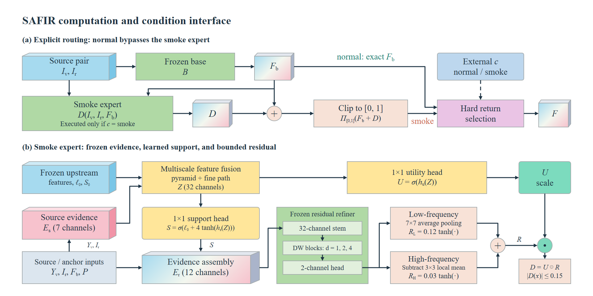
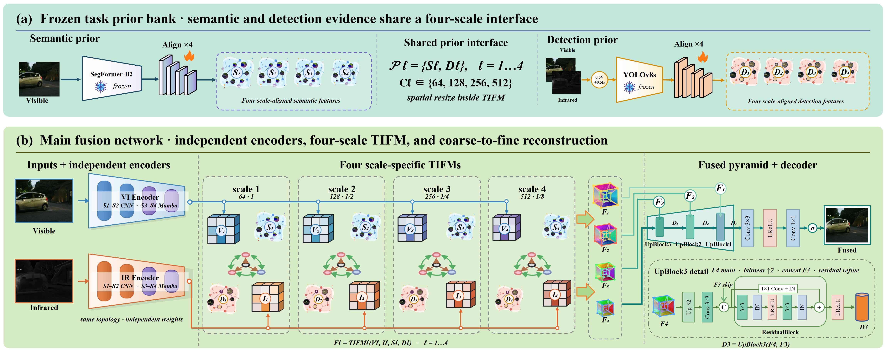
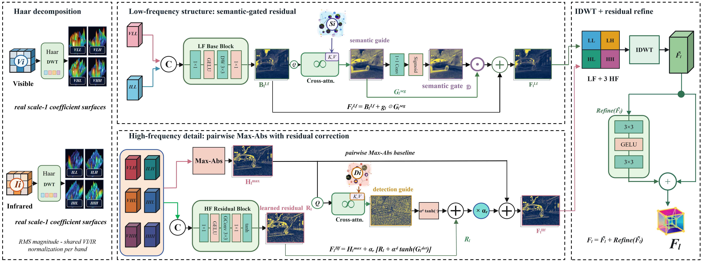
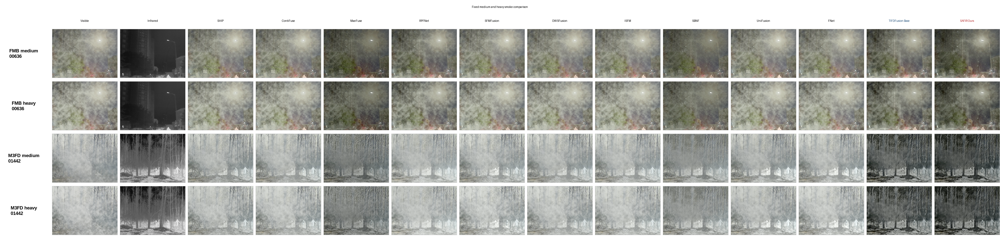
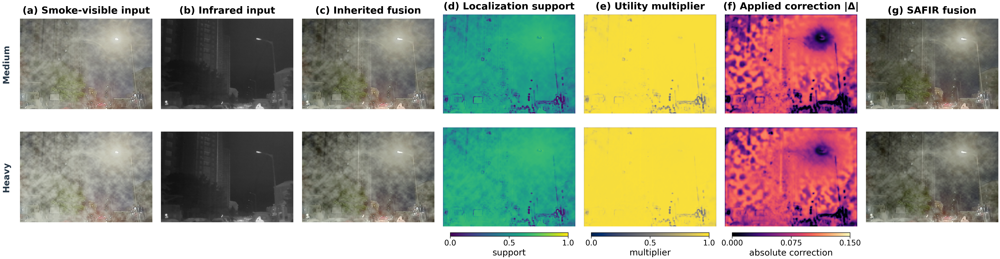

<div align="center">

# SAFIR

### Task-Interactive Infrared–Visible Fusion With Frequency Division and Conditional Smoke Correction

<a href="https://github.com/eliaukyh17-droid/SAFIR/releases/tag/weights-v0.2.0"></a>
<a href="https://github.com/eliaukyh17-droid/SAFIR/releases/download/weights-v0.2.0/SAFIR_final.safetensors"></a>
<a href="https://github.com/eliaukyh17-droid/SAFIR/blob/main/docs/WEIGHT_FORMAT.md"></a>

**TIFDFusion backbone · task-guided frequency division · bounded conditional smoke correction**

<p>
  <a href="#overview">Overview</a> ·
  <a href="#visual-overview">Visual overview</a> ·
  <a href="#quick-start">Quick start</a> ·
  <a href="#project-updates">Project updates</a> ·
  <a href="#repository-map">Repository map</a>
</p>

</div>

This repository provides the SAFIR and TIFDFusion model source, pretrained weights, staged training, paired-image inference, smoke synthesis, and evaluation tools.

## Overview

SAFIR combines the original **TIFDFusion** backbone with a conditional smoke-correction expert. TIFDFusion exchanges semantic and detection evidence with the visible–infrared fusion features at multiple scales and separates low-frequency structure from high-frequency detail. SAFIR then accepts an externally supplied condition:

- `normal` returns the frozen backbone output exactly;
- `smoke` applies a bounded residual correction and clips the result to `[0, 1]`.

The condition is supplied by the caller. `normal` preserves the original fusion mapping, while `smoke` activates the expert.

## Visual overview

### SAFIR routing and smoke-expert interface

<p align="center">
  
</p>

The routing diagram shows the identity-preserving normal path, the conditional smoke path, the learned support and utility maps, and the pointwise residual bound.

### TIFDFusion backbone architecture

<p align="center">
  
</p>

The backbone uses independent visible and infrared encoders, four scale-specific TIFM blocks, frozen semantic and detection priors, and a coarse-to-fine fusion decoder.

### Frequency-specific task interaction in TIFDFusion

<p align="center">
  
</p>

The TIFM detail view separates Haar low-frequency structure from high-frequency detail. Semantic evidence guides the low-frequency branch, while detection evidence corrects the high-frequency residual before inverse reconstruction.

## Output visualizations

The following qualitative panels are taken from the paper's fixed smoke comparisons. They illustrate the fused outputs and the learned correction response.

<table>
  <tr>
    <td align="center" width="50%">
      <br>
      <sub>Medium/heavy smoke comparison across source images, external methods, TIFDFusion, and SAFIR.</sub>
    </td>
    <td align="center" width="50%">
      <br>
      <sub>Smoke-visible input, inherited fusion, localization support, utility multiplier, applied correction, and SAFIR output.</sub>
    </td>
  </tr>
</table>


## Quick start

```bash
git clone https://github.com/eliaukyh17-droid/SAFIR.git
cd SAFIR
```

Follow **[Installation](docs/INSTALL.md)** to create a CPU or CUDA environment, then download the final checkpoint and matching pretrained priors:

```bash
python -m tools.download_weights
python -m safir.infer --visible datasets/MSRS/test/vi --infrared datasets/MSRS/test/ir --condition normal --output runs/msrs_clean --device cpu
```

Use `--condition smoke` for smoke-degraded visible inputs. For Linux CUDA inference, use `--device cuda:0 --scan-backend cuda` after installing the documented Mamba wheel. `--save-base` also saves the TIFDFusion output for comparison. Input pairs must have matching filenames and spatial dimensions; outputs retain their original resolution.

| Task | Entry point | Guide |
| --- | --- | --- |
| Fuse your image pairs | `python -m safir.infer` | [Inference and training](docs/TRAINING_AND_TESTING.md) |
| Train the backbone and smoke expert | `python -m safir.train` | [Stage schedules and commands](docs/TRAINING_AND_TESTING.md) |
| Generate smoke, infer, and evaluate | `python -m safir.benchmark` | [Benchmark and downstream tasks](docs/EVALUATION.md) |
| Evaluate existing fusion outputs | `python -m safir.evaluate` | [Metric definitions](docs/EVALUATION.md) |

## Pretrained model

Download **[SAFIR_final.safetensors](https://github.com/eliaukyh17-droid/SAFIR/releases/download/weights-v0.2.0/SAFIR_final.safetensors)** from the [weights release](https://github.com/eliaukyh17-droid/SAFIR/releases/tag/weights-v0.2.0), or use the downloader above. The single file contains the retained state of all fusion and smoke-adaptation stages. The loader restores the matching SegFormer and YOLO priors from their official checkpoints and checks the complete model state.

The frozen fusion priors are available directly from their official hosts:

| Prior | Official download | Local destination |
| --- | --- | --- |
| SegFormer-B2, Cityscapes | [Weights](https://huggingface.co/nvidia/segformer-b2-finetuned-cityscapes-1024-1024/resolve/d633b2072669ca68d8f8e309de9b52bfdbf6bf72/pytorch_model.bin), [configuration](https://huggingface.co/nvidia/segformer-b2-finetuned-cityscapes-1024-1024/resolve/d633b2072669ca68d8f8e309de9b52bfdbf6bf72/config.json) | `pretrained/segformer-b2/` |
| YOLOv8s, COCO | [Weights](https://github.com/ultralytics/assets/releases/download/v8.1.0/yolov8s.pt) | `pretrained/yolov8s.pt` |

`python -m tools.download_weights` downloads and verifies these files automatically. The FMB and M3FD task evaluators were trained separately for downstream scoring; their checkpoint identities are documented in the [evaluation guide](docs/EVALUATION.md#fixed-downstream-evaluators).

The release was checked against the original stage checkpoints: all **1,526 model tensors** match, and the reconstructed models produced identical outputs on the CPU comparison input. Real-image inference, fusion metrics, and one optimizer step for each smoke-adaptation stage were also checked. See [validation details](docs/VALIDATION.md).

## Training and evaluation

Training uses the supplied MSRS train/validation manifests. The six adaptation stages are exposed individually, with their original losses, seeds, and schedules. For a complete new training run, train the backbone first and pass each stage's checkpoint to the next stage.

```bash
python -m safir.train --stage base --msrs-root datasets/MSRS --output runs/base --device cuda:0 --scan-backend cuda
```

The benchmark covers clean, medium-smoke, and heavy-smoke inputs on MSRS, FMB, and M3FD, with TNO and RoadScene as extensions. Dataset paths are configured in `configs/benchmark.yaml`.

```bash
python -m safir.benchmark --datasets msrs fmb m3fd --output runs/benchmark --device cuda:0 --scan-backend cuda
```

The [evaluation guide](docs/EVALUATION.md) describes the 21 fusion metrics, reference-based recovery measures, and fixed downstream evaluators. Download the original FMB segmentation and M3FD detection checkpoints from the [evaluator release](https://github.com/eliaukyh17-droid/SAFIR/releases/tag/evaluators-v1.0.0), or run:

```bash
python -m tools.download_weights --only evaluators
```

## Project updates

- Model definitions, checkpoint loading, staged training, inference, smoke synthesis, and evaluation code are now available.
- The original fixed FMB segmentation and M3FD detection evaluator checkpoints are available with verified SHA256 values.
- We will continue adding project files and supporting evaluation assets.

## Repository map

| Path | Purpose |
| --- | --- |
| `models/` | TIFDFusion, TIFM, encoders/decoder, and SAFIR smoke expert |
| `safir/` | Public model loader and inference/training/evaluation commands |
| `data/` | Paired-image loading and deterministic smoke synthesis |
| `configs/`, `manifests/` | Training schedules, benchmark paths, and sample splits |
| `utils/` | Fusion metrics and training protocol utilities |
| `weights/` | Checkpoint metadata and download information |
| `docs/assets/` | Architecture figures and qualitative outputs from the paper |
| `reference_scripts/` | Original archived training/inference runners |
| `tests/` | Numerical, data, and checkpoint-loading checks |

## Attribution

Please cite the accompanying SAFIR manuscript when using this work. Third-party software and pretrained priors retain their own terms; see [third-party notices](THIRD_PARTY_NOTICES.md). No repository-wide reuse license has been assigned yet.
